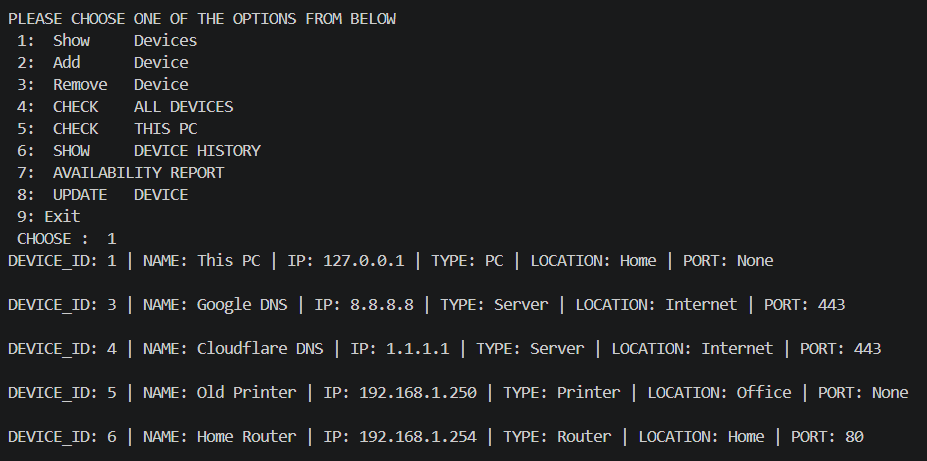
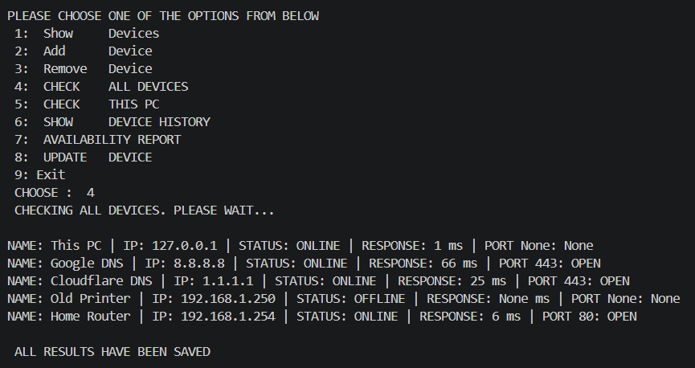
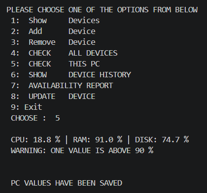
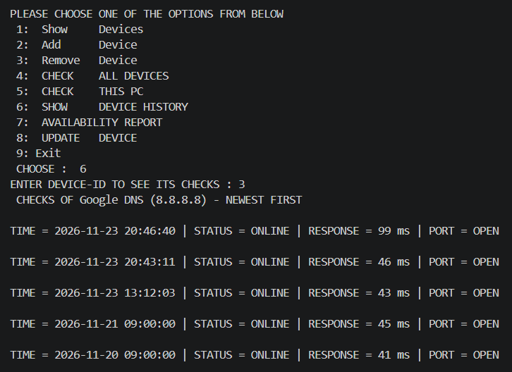
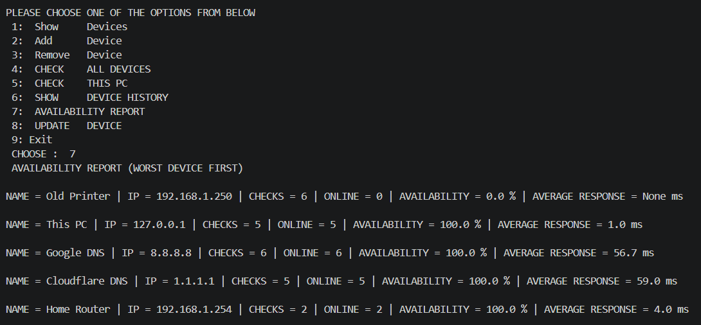
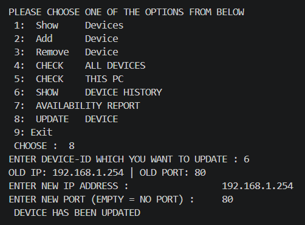
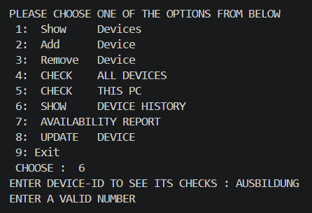

# IT Monitor (MySQL + Python)

A small IT monitoring tool. The devices of a network (PC, router, servers, printer) are saved in MySQL, and a Python console program checks them with ping and a port check, saves every result and shows reports. It also reads the load of the own PC (CPU, RAM, disk). I made it after my online shop project to learn how a company keeps an eye on its IT systems.

Kurzbeschreibung (Deutsch): Übungsprojekt zu Netzwerk-Monitoring mit Python und MySQL. Eine Konsolenanwendung prüft Geräte per Ping und Port-Check, speichert die Ergebnisse in einer MySQL-Datenbank und wertet die Verfügbarkeit per SQL aus.

## Tables

- `devices` - what is checked: device_id (primary key), name, ip_address, device_type, location, port (optional)
- `checks` - one row per check: check_id (primary key), device_id (foreign key to devices), check_time, status (ONLINE or OFFLINE), response_ms, port_status (OPEN or CLOSED)
- `system_stats` - load of the own PC: stat_id (primary key), stat_time, cpu_percent, ram_percent, disk_percent

## How the tables are connected

- One device can have many checks.
- If a device is removed, its old checks are removed too (`ON DELETE CASCADE`).
- `system_stats` stands alone, it only belongs to the PC the program runs on.

## Files

- `schema.sql` - creates the database and the three tables
- `sample_data.sql` - inserts test data (5 devices, 8 checks, 2 PC values)
- `queries.sql` - four analyses: availability per device, outages per day, devices that were offline, average and highest PC load
- `monitor.py` - the Python console program
- `requirements.txt` - the Python packages needed (`mysql-connector-python`, `psutil`)

## How to run

1. Install MySQL, MySQL Workbench and Python 3.
2. Open `schema.sql` in Workbench and run it. (If the database `it_monitor` already exists, run `DROP DATABASE it_monitor;` first.)
3. Optional: open `sample_data.sql` and run it, to have some data for the reports straight away.
4. Install the Python packages: `py -m pip install -r requirements.txt`
5. Start the program: `py monitor.py`
6. Type your MySQL root password when asked. It is hidden while you type and is not saved in the code.

The program connects to `localhost` as user `root` and uses the database `it_monitor`. It was written for Windows.

## The Python program

Menu options:

| Option | What it does |
|---|---|
| 1 | Show all devices |
| 2 | Add a device |
| 3 | Remove a device (and its old checks) |
| 4 | Check all devices now (ping + port check) and save the results |
| 5 | Check this PC (CPU, RAM, disk) and save the values |
| 6 | Show the check history of one device (newest first) |
| 7 | Availability report (worst device first) |
| 8 | Update a device (new IP address or port) |
| 9 | Exit |

How a check works (option 4):

1. The program reads all devices from the database.
2. For every device it runs `ping` once. If the answer contains `TTL=`, the device is ONLINE and the response time is read from the answer. Otherwise it is OFFLINE.
3. If the device has a port, the program tries to open a connection to it. If it works within 2 seconds, the port is OPEN, otherwise CLOSED.
4. Every result is saved in `checks` with the time. All results are saved together (commit). If something fails, nothing is saved (rollback).

Other details:

- Windows answers "Destination host unreachable" without an error, so the program does not trust the error code of ping. It looks for `TTL=` in the answer instead.
- If CPU, RAM or disk are above 90 %, the program shows a warning.
- Inputs are checked: empty text, letters instead of numbers and ports outside 1-65535 are rejected.
- Values go into the SQL with `%s` placeholders, not by joining text, which protects against SQL injection.
- The password is asked with `getpass` and is never written in the code.

## Screenshots

The screenshots were taken on my own home network. I removed the sample router (192.168.1.1) and added my real router (192.168.1.254), so it has device ID 6. The printer address 192.168.1.250 is not used in my network on purpose, to show how an OFFLINE device looks.

Menu and device list (option 1):

Check all devices (option 4):

Check this PC (option 5):

Check history of one device (option 6):

Availability report (option 7):

Update a device (option 8):

Wrong input is rejected:

Average and highest PC load (query 4 in `queries.sql`) in MySQL Workbench:

## What I learned

- What ping, IP addresses and ports are, and how to check them with Python (`subprocess`, `socket`)
- How to read system values like CPU and RAM with `psutil`
- How to save measurements over time and analyse them with SQL (COUNT, SUM, AVG, GROUP BY)
- How to calculate availability in percent, which is an important number in IT operations
- How to add, show, update and delete data (CRUD) from Python

## What I would improve

- Run the checks automatically every few minutes (for example with the Windows Task Scheduler)
- Send an email when a device goes offline
- Check several ports per device
- Show the results as a chart
- Export the availability report to a CSV file for Excel
- Check all devices at the same time instead of one after another, so it is faster with many devices

Author: Abdul Rehman
